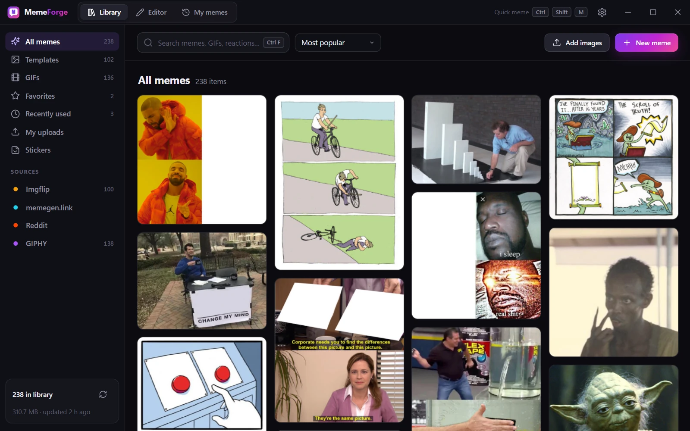
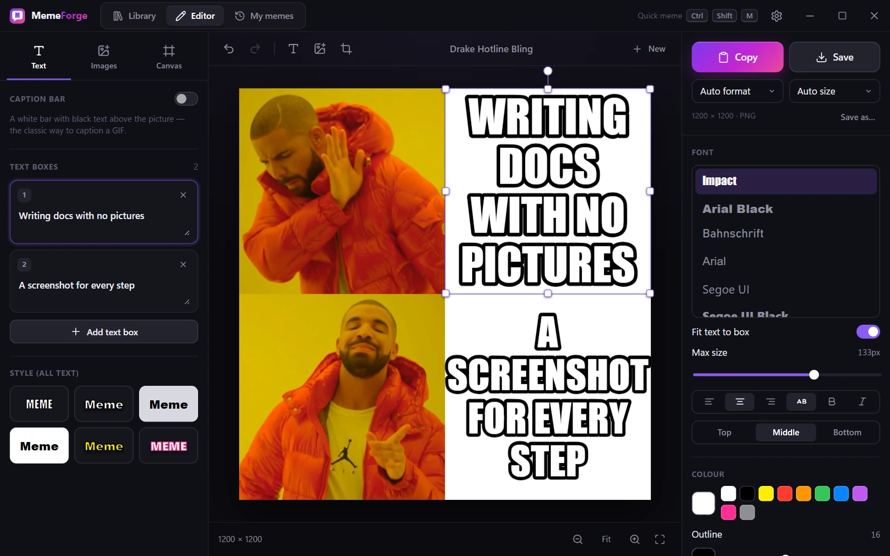
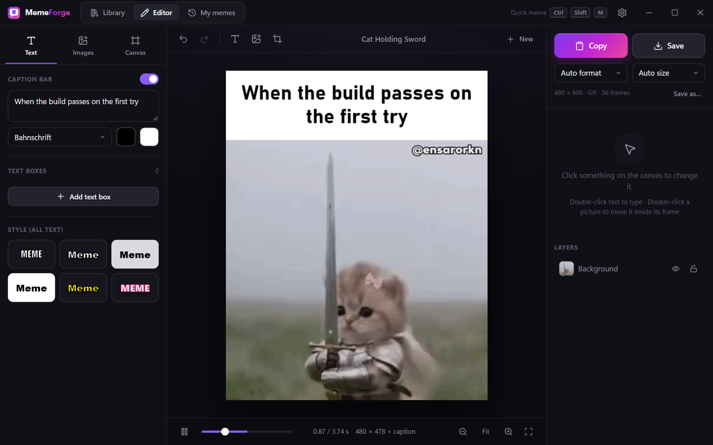
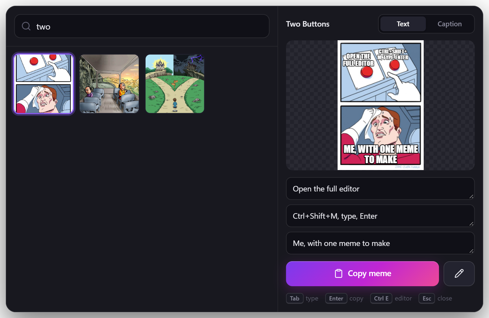

# MemeForge

A fast meme and GIF maker for Windows, written in Rust (Tauri 2 + WebView2).



- **Library** of popular templates, downloaded and refreshed weekly: Imgflip and memegen.link out of the box, trending GIFs from GIPHY and templates from Reddit with a free key/app ID. Search everything, including online results.
- **Editor**: any number of text boxes (classic Impact with outline, or any font), drag / resize / rotate with snapping, caption bar for GIFs, image and PNG stickers, emoji, panel layouts, crop, padding, animation speed, undo/redo.
- **Animated memes**: put text and stickers on GIFs; export GIF (one shared palette + only-changed-pixels frames, so files stay small) or MP4 (via FFmpeg).
- **Copy to clipboard** in one click: pictures as images, GIFs/MP4s as files so Discord and other apps paste the animation. Every export also lands in your memes folder.
- **Quick meme hotkey** (Ctrl+Shift+M): search a template, type, Enter. Done.
- **My memes**: everything you made, to copy again or keep editing.
- Self-updates from GitHub releases.

## How it works

| | |
|---|---|
|  |  |
| **1. Pick a template and type.** Text fits its box automatically; drag, resize or rotate anything on the canvas, then **Copy** puts the meme on the clipboard. | **2. Caption a GIF.** Turn on the caption bar, type, and export as a small GIF or MP4. Discord pastes the animation. |
|  | |
| **3. Or skip the window.** Ctrl+Shift+M opens the quick popup from anywhere: search, type, Enter copies it. Ctrl+E moves it to the full editor. | |

## Install

Download `MemeForge-x.y.z-setup.exe` from [Releases](https://github.com/JustSad42/memeforge/releases). It installs per-user (no admin) to `%LOCALAPPDATA%\Programs\MemeForge`.

## Build

```powershell
cd rust
cargo build --release      # target\release\memeforge.exe
cargo test
..\release.ps1             # + installer in dist\ (needs Inno Setup 6)
```

The UI is plain HTML/CSS/JS in `rust/ui` (no bundler). Rendering happens on a canvas in the page so the export matches the editor exactly; Rust does library downloads, GIF/MP4 encoding, the clipboard, the tray and the global hotkey.

Set `MEMEFORGE_DATA=<folder>` to run a copy with its own settings and library.

## Licence

MIT. Icons by [Lucide](https://lucide.dev) (ISC). Meme images are downloaded at runtime and belong to their owners.
